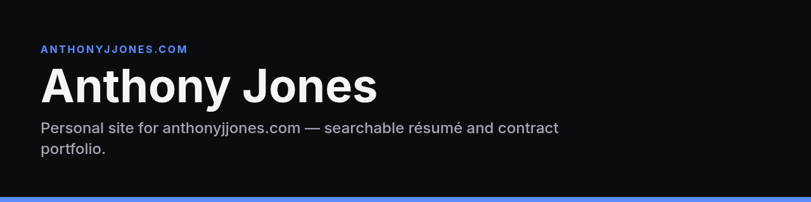

<p align="center">
  
</p>

# Anthony Jones

**Personal site for anthonyjjones.com — searchable résumé and contract portfolio.**

[](#license)


Personal site for [anthonyjjones.com](https://anthonyjjones.com). It is a searchable résumé and contract portfolio: services, selected work, skills, experience, and a plain résumé with a PDF download.

The pages are static files. Edit `content.json`, rebuild, and upload the contents of `dist/` to Hostinger `public_html`. Nothing here deploys on its own.

## Edit the site

`content.json` is the only source of copy, projects, skills, experience, education, contact details, and theme colors. The layout does not hardcode that text.

- Reorder projects, services, skill groups, experience, or education by moving items in their arrays.
- Section order on the page follows each block's `sectionIndex` (`01`, `02`, …). Change the number to move a section.
- Skill groups and the contract experience role use a `tags` array. Tags must match `filters.tags` exactly. Those tags connect the item to the filter chips.
- `theme.accent` and the `theme.dark` / `theme.light` colors are applied at build time. Text and control colors are adjusted only when needed so contrast stays at WCAG AA.

Fields whose value starts with `TODO:` are left in the file for Anthony to finish. The build hides them. It does not print the word TODO on the site. Open items are listed in `placeholders.json` after each build.

The public email is confirmed: `ajnthony87@gmail.com`. It is the address in the contact section, the résumé, the PDF, and the Person schema.

Do not add a phone number to this repository. The repo is public.

Confirmed client names stay out until `work.clientWork.note` no longer starts with `TODO:`.

## Preview and build

Requires Node 20+ and Chrome or Chromium (used only to render `resume.pdf`, `og.png`, and the favicon PNG/ICO).

```bash
npm install
npm run build
npm run serve
```

`npm run build` writes `dist/`. `npm run serve` hosts that folder at `http://127.0.0.1:4173`.

Open `/` for the site, `/resume.html` to print or read the résumé, and `/resume.pdf` to download it. Case studies live at `/work/<slug>.html`.

## Search and filters

The search field filters projects, services, skills, experience, and education in the browser.

- Press `/` or Ctrl+K (Command+K on a Mac) to focus search.
- Filter chips match any selected tag (`?tag=Payments&tag=iOS%20%2F%20Mobile`).
- A text query is `?q=vision`.
- An open case study is `?project=passokay`.
- Skill names are buttons. Choosing one searches for that skill.

Without JavaScript the full content is still in the page. Filtering is the enhanced behavior.

## Résumé

`/resume.html` is a single column of selectable text for printing and for applicant-tracking systems. Print styles drop the site header, navigation, and theme. If `src/resume.pdf` exists, `npm run build` copies it to `dist/resume.pdf` as the downloadable résumé (keep it free of a phone number; this repo is public). Without it, the PDF is generated from `/resume.html`.

## Theme

The default theme is dark. The theme control stores `light` or `dark` in `localStorage`. Motion is limited to color changes, and `prefers-reduced-motion: reduce` removes those too.

## Deploy to Hostinger

Do this from hPanel on the Cloud Startup plan. Upload files yourself. This project does not ship them.

1. In hPanel, add `anthonyjjones.com` as a website on the hosting plan if it is not added yet.
2. Open File Manager or SFTP and go to that site's `public_html`.
3. Upload the **contents** of `dist/` so `index.html` sits directly in `public_html`, along with `assets/`, `work/`, `resume.html`, `resume.pdf`, `sitemap.xml`, `robots.txt`, and the favicon files.
4. Turn on the free SSL certificate and open `https://anthonyjjones.com`.

The site expects to be served from the domain root (`/assets/...`, `/resume.pdf`). After content changes, run `npm run build` again and replace the files in `public_html`.

## What the build writes

| Path | Role |
| --- | --- |
| `dist/index.html` | Portfolio |
| `dist/work/*.html` | Case studies |
| `dist/resume.html` | Printable résumé |
| `dist/resume.pdf` | Downloadable résumé |
| `dist/sitemap.xml`, `dist/robots.txt` | Crawling |
| `dist/og.png` | Open Graph image, until `meta.ogImage` points at a replacement |
| `dist/favicon.svg`, `favicon.png`, `favicon.ico`, `apple-touch-icon.png` | Icons |
| `dist/assets/` | CSS, JS, fonts |


## License

All rights reserved.
